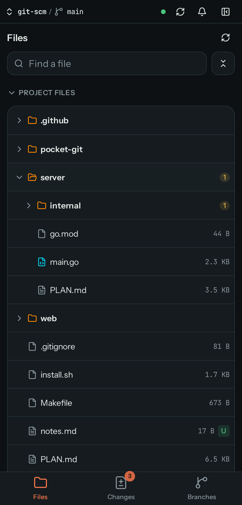
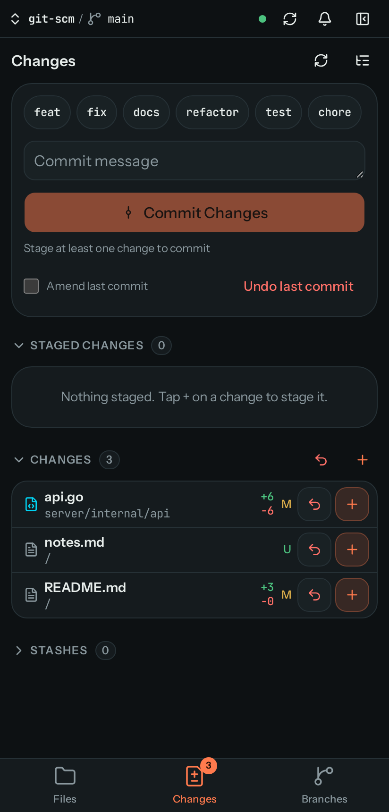
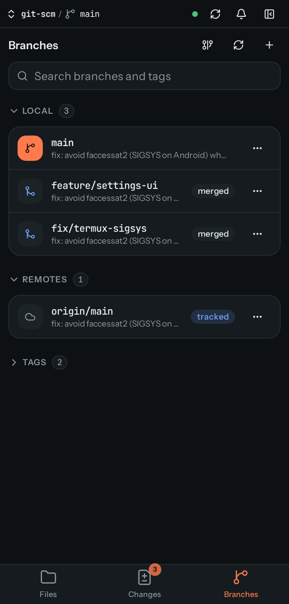
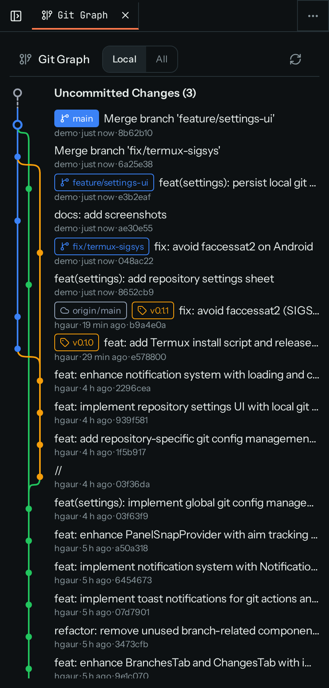
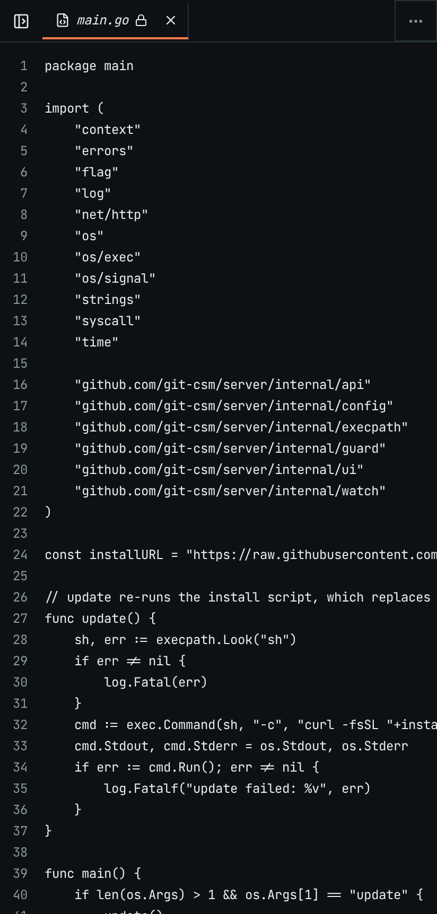

# git csm

Mobile-first PWA for source control and code browsing. A single Go binary serves the app (frontend embedded) on localhost; built to run in Termux.

## Screenshots

<table>
  <tr>
    <td align="center"><br><b>Files</b></td>
    <td align="center"><br><b>Changes</b></td>
    <td align="center"><br><b>Branches</b></td>
    <td align="center"><br><b>Git graph</b></td>
    <td align="center"><br><b>Editor</b></td>
  </tr>
</table>

## Install (Termux)

```sh
curl -fsSL https://raw.githubusercontent.com/harshG775/git-scm/main/install.sh | sh
```

This downloads the latest release binary for your architecture, verifies its SHA-256 checksum, and installs it to `$PREFIX/bin` (or `~/.local/bin` outside Termux). It also installs `git` through `pkg` if missing.

Then run:

```sh
git-csm
```

and open <http://localhost:8080> in your browser. Install it to the home screen from the browser menu to use it as an app.

Options:

| Flag | Default | |
| --- | --- | --- |
| `-addr` | `127.0.0.1:8080` | listen address |
| `-cert`, `-key` | | TLS certificate and key (enables HTTPS) |
| `-allow-hosts` | | extra host names to accept, comma-separated |

## Update

```sh
git-csm update
```

This re-runs the install script and replaces the binary with the latest release. Restart `git-csm` afterwards. Running the curl install command again does the same thing.

Pin a version: `GIT_CSM_VERSION=v0.1.0 sh install.sh`.

## Build from source

Needs Go and [Vite+](https://viteplus.dev) (`vp`).

```sh
make build   # builds the web app, embeds it, writes bin/git-csm
make run     # rebuild the frontend and run the server on :8080
```

See [PLAN.md](PLAN.md) for the design.

## Releasing

Push a version tag; GitHub Actions builds `linux/arm64` and `linux/amd64` binaries plus `checksums.txt` and attaches them to a release.

```sh
git tag v0.1.0 && git push origin v0.1.0
```
